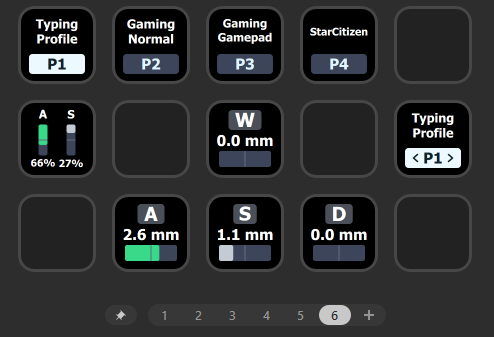

# WootDeck

A Stream Deck plugin for Wooting keyboards: switch onboard profiles and see
physical key pressure directly on your Stream Deck.

## Features

- **Select Profile** — activate a specific onboard profile.
- **Cycle Profiles** — cycle forward or backward, with separate short- and
  long-press directions.
- **Toggle Profiles** — switch between two selected profiles.
- **Current Profile** — display the active profile, including external changes.
- **Key Pressure** — show one physical key or multiple pressed keys, with
  configured actuation markers and threshold-based colors.
- Customizable color themes, fonts, profile boxes and transitions; save your
  own design presets.

Wootility and the Wooting Background Service can remain running.

## Installation

Download the Windows `.streamDeckPlugin` file from **GitHub Releases** and open
it with Stream Deck. Add an action from the **WootDeck** category, select your
keyboard and configure the action.

Development builds are also available as downloadable artifacts from successful
GitHub Actions runs.

## Compatibility

- Windows x64 and Stream Deck 7.1 or newer.
- So far, only the **Wooting Two HE (ARM, firmware 2.14.2)** has been tested.
- Key pressure uses the Wooting Analog SDK. Keep the official SDK installed.
- Other models and firmware versions require separate validation.

This is an early beta. Profile switching uses onboard profiles; inactive
Wootility library profiles and App Linking are outside the current scope.

## AI Assistance

WootDeck is developed with AI assistance using OpenAI Codex, including code,
documentation, tests and design iterations. Features and design decisions are
directed by the project maintainer. AI assistance does not replace hardware
validation; the compatibility limits above still apply.

## License

Original WootDeck code is **GPL-3.0-or-later**. See [LICENSE](LICENSE) and
[NOTICE.md](NOTICE.md). Third-party components retain their own licenses;
their notices are included with the plugin.

WootDeck is an independent project and is not affiliated with Wooting or Elgato.
